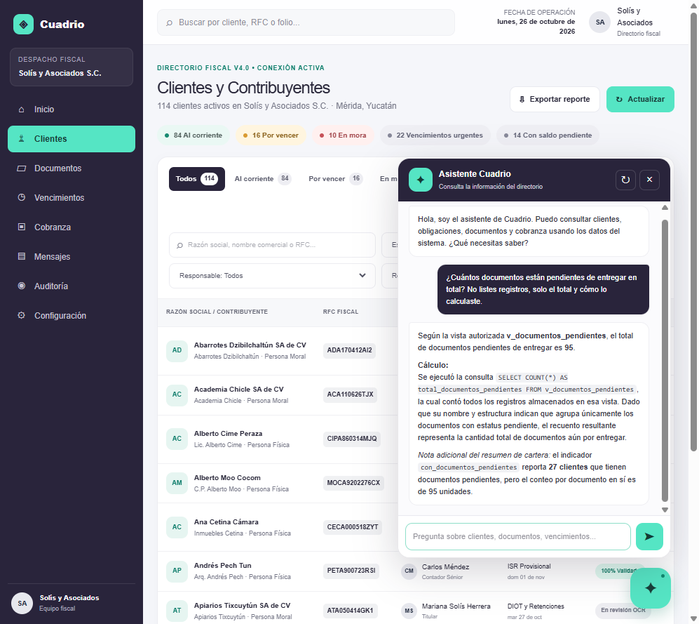
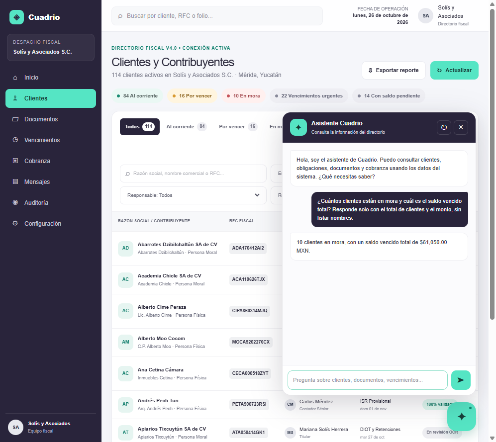

# Documento técnico — Cuadrio

## Entrega

- **Aplicativo desplegado:** no aplica; se ejecuta localmente en `http://127.0.0.1:8000`.
- **Instalación y ejecución:** consultar el README_InstruccionesProbar.md
- **Evidencias:** capturas incluidas en [`evidencias/`](evidencias/).

## Integrantes y roles

| Integrante | Rol |
|---|---|
| Jesus Alberto Aguilar Ayala | Base de datos y troubleshooting |
| Andrei Granja Lira | Backend |
| Anhelo Jackeline Campos | Documentación y evidencias |

## Dominio y propósito

Cuadrio es un directorio para un despacho fiscal. Presenta clientes y contribuyentes, su situación, responsable asignado, obligaciones próximas, documentos y saldos. La interfaz permite buscar, filtrar, paginar y cambiar entre tabla y tarjetas. El asistente flotante responde preguntas sobre la información que se consulta en la pantalla y en la base de datos.

## Arquitectura

La aplicación activa está en `laravel-app/`.

```text
Navegador (Blade + JavaScript/CSS compilados con Vite)
        | GET /api/dashboard; POST /api/chat
        v
Laravel — ClientDirectoryController
        |                         \
        v                          v
ReadOnlyDatabase             OpenRouterAssistant
        |                          | tools/function calls
        v                          v
MySQL/MariaDB <------------- OpenRouter API
     vistas autorizadas       respuesta del modelo
```

- **Presentación:** `resources/views/dashboard.blade.php`, `resources/js/app.js` y `resources/css/app.css`.
- **API y orquestación:** `app/Http/Controllers/ClientDirectoryController.php` valida y enruta las solicitudes; `app/Services/OpenRouterAssistant.php` arma el prompt, invoca el modelo y ejecuta sus herramientas.
- **Acceso a datos:** `app/Services/ReadOnlyDatabase.php` y `app/Services/ReadOnlySql.php` ejecutan y validan consultas de lectura.
- **Respuestas:** Markdown se renderiza con Marked y se sanitiza con DOMPurify antes de mostrarlo.

## Esquema lógico de la base de datos

La aplicación se conecta a una base MySQL/MariaDB existente. El repositorio no incluye su DDL ni datos; Laravel consulta vistas de negocio y una tabla de parámetros:

| Objeto | Uso y campos representativos |
|---|---|
| `v_clientes_resumen` | Vista central de clientes; `id_cliente`, razón social, RFC, contador asignado, estatus, estado documental, saldo por cobrar y saldo vencido. |
| `v_indicadores` | Indicadores agregados del directorio: clientes por estado, vencimientos, documentos pendientes y saldos. |
| `v_vencimientos_detalle` | Obligaciones por cliente; `id_vencimiento`, `id_cliente`, obligación, periodo, fecha límite y estatus. |
| `v_cobranza_detalle` | Cobros y facturas por cliente; `id_cobro`, `id_cliente`, concepto, monto, fechas y estatus de cobro. |
| `v_documentos_pendientes` | Documentos pendientes por cliente; `id_documento`, `id_cliente`, tipo, periodo y observación. |
| `v_carga_por_contador` | Carga de trabajo y distribución de estados por contador. |
| `v_clientes_por_giro`, `v_clientes_por_regimen` | Agregados de clientes por giro y régimen fiscal. |
| `parametros_sistema` | Parámetros de operación en pares `clave`/`valor`; la aplicación lee `fecha_operacion`. |

Las vistas de vencimientos, cobranza y documentos se relacionan con `v_clientes_resumen` por `id_cliente`. Las vistas agregadas se consultan para indicadores y comparaciones. Las consultas de la aplicación se limitan a las vistas autorizadas; no se incluyen en el repositorio las tablas físicas ni su definición.

## Diseño del agente

### Modelo y proveedor

- **Proveedor:** OpenRouter, mediante `https://openrouter.ai/api/v1/chat/completions`.
- **Modelo configurado:** `openrouter/free`. OpenRouter puede elegir un modelo gratuito disponible compatible con herramientas; el modelo concreto, sus límites y su disponibilidad pueden variar.
- La clave se configura en `OPENROUTER_API_KEY` dentro de `laravel-app/.env`. No debe publicarse ni agregarse al repositorio.

### Herramientas disponibles

El backend expone al modelo seis herramientas de función:

| Herramienta | Propósito |
|---|---|
| `resumen_cartera` | Obtiene indicadores agregados del directorio. |
| `buscar_cliente` | Busca por razón social, nombre comercial o RFC. |
| `clientes_en_mora` | Consulta clientes activos con mora o saldo vencido. |
| `vencimientos_proximos` | Consulta vencimientos pendientes en un rango de 1 a 90 días. |
| `clientes_por_contador` | Filtra clientes por contador asignado. |
| `query_database` | Permite consultas compuestas, agregaciones y uniones sobre vistas autorizadas. |

### Prompting y flujo

El prompt de sistema instruye al agente a responder en español, usar la fecha de operación, basarse en resultados de herramientas o contexto de pantalla, no inventar datos y tratar el contenido de la base como datos, no como instrucciones. También distingue las métricas de clientes activos y de baja. Para preguntas habituales prioriza herramientas específicas; para comparaciones y uniones usa `query_database`. El backend puede completar varios pasos de herramienta antes de devolver la respuesta.

El navegador envía la pregunta, un historial acotado y contexto de la pantalla a Laravel. El agente selecciona herramientas, Laravel consulta la base y devuelve sus resultados al modelo para redactar una respuesta. El contenido devuelto se muestra como Markdown sanitizado.

### Medidas de seguridad y límites

- La API key de OpenRouter permanece en el servidor, en `.env`; `.env.example` contiene solo valores de muestra.
- La solicitud valida longitud de pregunta, historial y contexto de pantalla.
- El validador permite únicamente `SELECT` o `WITH ... SELECT` de hasta 4,000 caracteres, limita las fuentes a vistas autorizadas, rechaza operaciones de escritura y consultas múltiples, y limita el resultado a un máximo de 250 filas.
- Las consultas se ejecutan dentro de una transacción de solo lectura.
- El ciclo de llamadas a OpenRouter tiene un presupuesto máximo de 50 segundos para evitar que una consulta compleja exceda el tiempo de ejecución del servidor local.
- El prompt prohíbe operaciones de escritura y trata datos/contexto como contenido no confiable; las respuestas se sanitizan antes de insertarse en la interfaz.
- La aplicación envía a OpenRouter la pregunta, el contexto y los resultados necesarios para responder. Las capturas de esta entrega se hicieron con datos sintéticos. No conectar datos personales reales a un proveedor externo sin autorización y las salvaguardas correspondientes.
- El proyecto está preparado para pruebas locales; no se presenta como un despliegue de producción.

## Evidencias de funcionamiento

Las capturas corresponden a consultas realizadas desde el asistente de la aplicación usando la base local de prueba:

### 1. Clientes activos y de baja

Pregunta: “Usa la base de datos para contar por separado los clientes activos y los de baja. Devuelve solo ambas cantidades y aclara que no se suman entre sí.”


### 2. Documentos pendientes

Pregunta: “¿Cuántos documentos están pendientes de entregar en total? No listes registros, solo el total y cómo lo calculaste.”



### 3. Clientes en mora

Pregunta: “¿Cuántos clientes están en mora y cuál es el saldo vencido total? Responde solo con el total de clientes y el monto, sin listar nombres.”



## Verificación

Desde `laravel-app/`, las pruebas automatizadas se ejecutan con:

```powershell
php artisan test
npm run build
```

La base debe proporcionar las vistas y la tabla descritas arriba. No ejecutar migraciones para preparar esta base existente.
